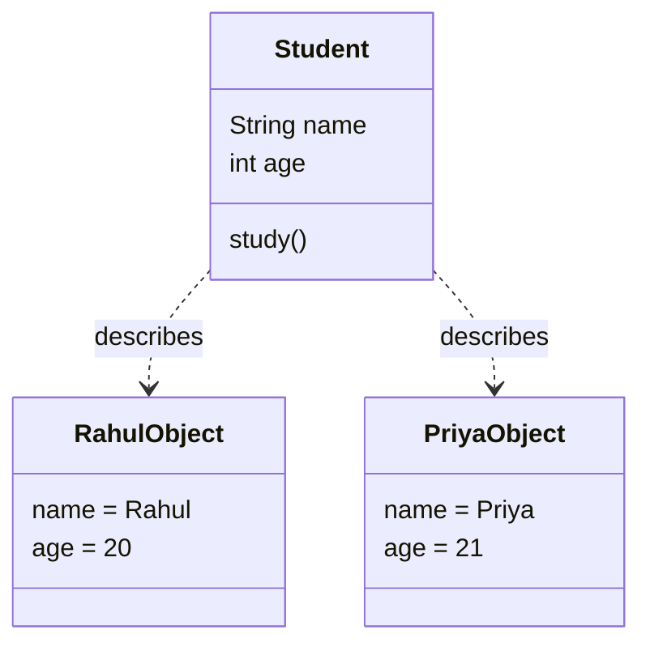
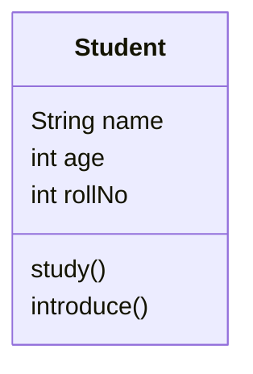
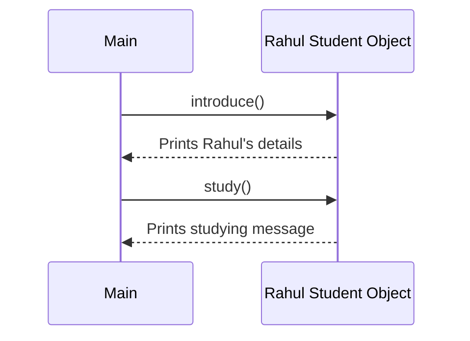
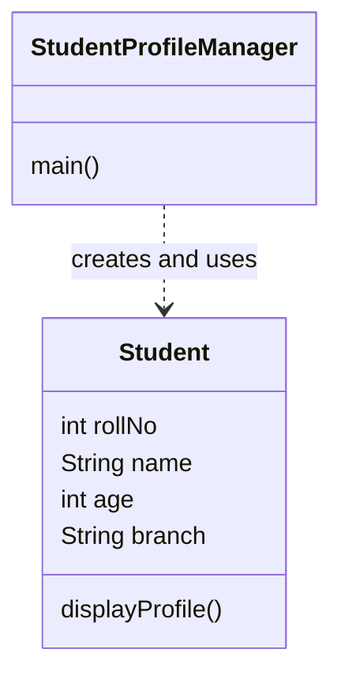
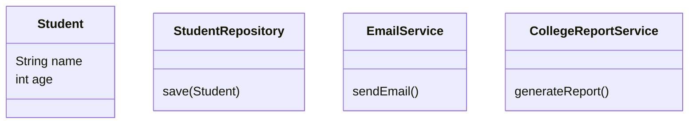

# OOP Concepts: Introduction, Classes, Objects, Attributes, and Behaviour

**Suggested filename:** `OOP_Introduction_Classes_Objects_Practice.md`  
**Primary source:** User-provided *OOPS Concepts, Video 1* PDF (11 pages).  
**Language:** Java  
**Teaching style:** Easy Hinglish in English letters

---

## Table of Contents

1. [Topic Overview](#1-topic-overview)
2. [What the Source Covers](#2-what-the-source-covers)
3. [Why OOP Exists](#3-why-oop-exists)
4. [What Is OOP?](#4-what-is-oop)
5. [Classes and Objects](#5-classes-and-objects)
6. [Attributes and Behaviour](#6-attributes-and-behaviour)
7. [A Runnable Java Example](#7-a-runnable-java-example)
8. [How Objects Work Behind the Scenes](#8-how-objects-work-behind-the-scenes)
9. [Visual Learning](#9-visual-learning)
10. [Common Mistakes and Corrections](#10-common-mistakes-and-corrections)
11. [Hands-On Coding Practice](#11-hands-on-coding-practice)
12. [OA Preparation](#12-oa-preparation)
13. [Technical Interview Preparation](#13-technical-interview-preparation)
14. [Real-World Mini Project](#14-real-world-mini-project)
15. [Solutions: Practice Exercises](#15-solutions-practice-exercises)
16. [Solutions: OA Questions](#16-solutions-oa-questions)
17. [Mini Project Reference Solution](#17-mini-project-reference-solution)
18. [Revision Notes and Cheat Sheet](#18-revision-notes-and-cheat-sheet)
19. [Self-Assessment](#19-self-assessment)

---

## 1. Topic Overview

### Topic

**Introduction to Object-Oriented Programming (OOP), classes, objects, attributes, and behaviour.**

### Learning objectives

After studying this file, you should be able to:

- Explain why OOP is useful when software grows.
- Explain the limitations of poorly structured procedural code without claiming that every procedural program is bad.
- Define a class and an object accurately.
- Identify an object's state and behaviour.
- Create multiple objects from one class.
- Write and run a small Java program using classes and objects.
- Explain the difference between a class blueprint and an object created from it.
- Identify when a class is a useful model and when creating a class adds unnecessary complexity.
- Answer beginner-to-intermediate OA and interview questions on these fundamentals.

### Why this concept exists

Imagine a college system with hundreds of students. Every student has information such as name, roll number, age, and branch. Students can perform actions such as studying or attending class.

If all the data and operations are spread across unrelated variables and functions, the program can become difficult to understand and change. OOP gives us a way to group related data and behaviour into meaningful software units called **objects**.

### Where developers use it

- College management: `Student`, `Course`, `Faculty`
- Banking: `BankAccount`, `Customer`
- E-commerce: `Product`, `Order`, `Payment`
- Employee management: `Employee`, `Department`
- Transport systems: `Vehicle`, `Car`, `Bus`
- Notification systems: `EmailNotification`, `SmsNotification`

These are modelling choices. A real-world noun does not automatically need to become a class. A class is useful when it represents a meaningful concept with clear data, responsibilities, and behaviour.

### Prerequisites

- Basic Java syntax: variables, data types, methods, and `main()`.
- You should know how to compile and run a basic Java program.
- No DSA knowledge is required for this document.

---

## 2. What the Source Covers

The supplied PDF is an introductory OOP lecture. Its main points are:

| Source location | Main idea |
|---|---|
| Pages 2 | OOP was developed in response to limitations found in earlier programming approaches. |
| Pages 3-4 | Modelling hundreds of students becomes messy if every student's properties and behaviour are handled without a clear structure. The diagrams show student information and actions such as `study()`, `sleep()`, and `bunk()`. |
| Page 5 | The lecture lists drawbacks of procedural-style code: weak real-world modelling, widespread changes when data changes, globally accessible data, unclear boundaries, and poor modularity as complexity grows. |
| Page 6 | OOP divides a program into objects that communicate. An object groups its data and behaviour, helping modularity, reuse, and maintainability. |
| Page 7 | One `Student` class can describe multiple individual student objects, each with different values. |
| Page 8 | A class is a blueprint; an object is an instance of a class. |
| Page 9 | Attributes represent state or properties; behaviour is represented by methods or functions an object can perform. |
| Pages 10-11 | OOP is a programming paradigm, and classes and objects are fundamental building blocks. The lecture names C++, Java, and JavaScript as languages that support object-oriented programming. |

### Clarifications that improve technical accuracy

The points below are supporting explanations, not additional claims attributed to the lecture.

1. **Procedural programming is not inherently bad.** It can be a good fit for small scripts and many other tasks. The concern is unmanaged complexity, shared mutable data, and unclear responsibilities.
2. **OOP is not only about copying real-world objects.** It is a way to organise software around objects with state, behaviour, and responsibilities. Software objects do not always map directly to physical things.
3. **Not every function needs to be inside an object.** Java uses classes for code organisation, but good design still depends on clear responsibilities rather than making a class for every noun.
4. **OOP does not automatically guarantee reuse or maintainability.** Poorly designed classes can make code harder to change. These benefits come from good design.
5. **JavaScript supports multiple programming styles**, including object-oriented, functional, and procedural styles. Languages are not always limited to one paradigm.
6. The lecture's phrase “something to hide” points toward information hiding, which is developed more fully through encapsulation and access control. This introductory file gives a preview but does not treat the complete encapsulation topic as already covered.

---

## 3. Why OOP Exists

### 3.1 Start with the problem

Suppose a college application needs to manage three students.

A simple procedural-style sketch might look like this:

```java
String student1Name = "Rahul";
int student1Age = 20;
int student1RollNo = 101;

String student2Name = "Priya";
int student2Age = 21;
int student2RollNo = 102;

String student3Name = "Aman";
int student3Age = 19;
int student3RollNo = 103;
```

This code is valid Java, but the naming pattern becomes repetitive. If the application needs many student details and operations, the code may become difficult to manage.

Now imagine functions that separately update student names, print details, validate ages, and calculate attendance. If each function receives unrelated values or accesses shared data in an unclear way, changes can spread across the program.

### 3.2 A more structured model

We can define a `Student` class once and create a separate object for each student.

```java
class Student {
    String name;
    int age;
    int rollNo;

    void study() {
        System.out.println(name + " is studying.");
    }
}
```

Then we can create multiple objects:

```java
Student student1 = new Student();
student1.name = "Rahul";
student1.age = 20;
student1.rollNo = 101;

Student student2 = new Student();
student2.name = "Priya";
student2.age = 21;
student2.rollNo = 102;
```

Both objects follow the same class structure, but each object has its own instance field values.

### 3.3 Limitations highlighted in the source

The lecture identifies these risks in poorly structured procedural code:

1. **Weak real-world modelling:** related properties and operations may be separated.
2. **Changes spread widely:** adding or changing data may require updates in many functions.
3. **Global data exposure:** data accessible from many places can be changed unexpectedly.
4. **Unclear boundaries:** it may be hard to identify which part of the program owns a responsibility.
5. **Weak modularity:** as the codebase grows, tightly connected code becomes harder to test and maintain.

These are possible design problems, not unavoidable properties of all procedural programming.

### 3.4 Practical comparison

| Less structured approach | Object-oriented approach |
|---|---|
| Student details may be spread across many variables. | A `Student` object groups related fields. |
| Functions may receive many separate values. | Methods can work with an object's state. |
| A shared data area may be modified by many functions. | A class can control access to its state, especially when encapsulation is used. |
| Boundaries may be unclear. | Classes can define responsibilities and interfaces. |
| Reuse depends on how the code is organised. | A well-designed class can be reused in different parts of a program. |

**Important:** OOP is a design tool, not a guarantee that code will be clean. A badly designed OOP program can still have duplicated logic, excessive dependencies, and unclear responsibilities.

---

## 4. What Is OOP?

### Beginner explanation

OOP ka full form **Object-Oriented Programming** hai.

Simple words mein, OOP ek programming approach hai jisme hum program ko meaningful objects ke around organise karte hain. Objects ke paas apna state/data ho sakta hai aur woh methods ke through behaviour perform kar sakte hain.

For example, a `Student` object can have:

- State: name, age, roll number
- Behaviour: `study()`, `attendClass()`

A `BankAccount` object can have:

- State: account holder and balance
- Behaviour: `deposit()` and `withdraw()`

The exact fields and methods depend on the software requirements.

### Formal definition

Object-Oriented Programming is a programming paradigm that organises software around objects that combine state and behaviour, with classes or other object mechanisms defining how those objects are structured and used.

### Core idea: group related state and behaviour

```text
Student object
+---------------------------+
| State / Attributes        |
| name = "Rahul"            |
| age = 20                  |
| rollNo = 101              |
+---------------------------+
| Behaviour / Methods       |
| study()                   |
| attendClass()             |
+---------------------------+
```

The state describes the current information held by the object. The behaviour describes operations associated with it.

### Why grouping helps

If a `Student` object owns its student-related state and methods, a developer can reason about that part of the program as a unit. It becomes easier to identify where a responsibility belongs.

Grouping data and behaviour is one foundation of encapsulation. Strong encapsulation additionally controls access to internal state.

### Is OOP only for real-world entities?

No. A software object can represent a physical entity, a business concept, or a technical service.

Examples:

- Physical: `Car`
- Business concept: `Invoice`
- Application concept: `Session`
- Service: `EmailSender`

The object should be based on a useful software responsibility, not just on a noun.

---

## 5. Classes and Objects

### 5.1 What is a class?

A **class** defines a type of object. In Java, a class can declare fields, constructors, and methods.

Easy Hinglish: Class ko blueprint ya design samjho. Blueprint batata hai ki us type ke objects mein kaunse fields aur methods ho sakte hain.

```java
class Student {
    String name;
    int age;

    void study() {
        System.out.println(name + " is studying.");
    }
}
```

Here:

- `Student` is the class name.
- `name` and `age` are instance fields.
- `study()` is an instance method.
- The class definition describes the structure and behaviour; it is not itself one particular student.

### 5.2 What is an object?

An **object** is an instance of a class.

```java
Student rahul = new Student();
```

Read it like this:

- `Student`: the declared reference type.
- `rahul`: a local reference variable.
- `new Student()`: creates a new `Student` object and invokes its constructor.
- `=`: assigns the returned reference to `rahul`.

The reference variable is not the object itself. It holds a reference to the object.

### 5.3 One class, multiple objects

```java
Student rahul = new Student();
rahul.name = "Rahul";
rahul.age = 20;

Student priya = new Student();
priya.name = "Priya";
priya.age = 21;
```

`rahul` and `priya` refer to two distinct objects. They use the same class definition but have separate instance field values.



This is a conceptual diagram. `RahulObject` and `PriyaObject` are labels for individual runtime objects, not separate Java classes.

### 5.4 Real-life analogy and its limits

**Analogy:** A building plan describes the layout of apartments. Individual apartments may follow the same plan while containing different furniture and occupants.

**Actual programming behaviour:** A Java class defines a type. Each object created with `new` has its own instance state. A class is not literally copied into a new source file for every object.

### 5.5 Class versus object

| Class | Object |
|---|---|
| Defines a type. | Is an instance of a type. |
| Declares possible fields and methods. | Has its own instance field values. |
| Example: `Student` | Example: one student object |
| Written as a class declaration. | Commonly created with `new Student()` |
| One class can describe many objects. | Each object has its own identity. |

### 5.6 A note about references

```java
Student first = new Student();
first.name = "Rahul";

Student second = first;
second.name = "Aman";

System.out.println(first.name);
```

Output:

```text
Aman
```

Why? `first` and `second` refer to the same object. Assigning `second = first` does not create a new `Student`.

---

## 6. Attributes and Behaviour

### 6.1 Attributes

Attributes are the data or properties associated with an object. In Java, they are commonly represented by fields.

```java
class Person {
    String name;
    int age;
    double height;
}
```

Here, `name`, `age`, and `height` are instance fields.

Easy Hinglish: Attributes object ki current information batate hain. Jaise student ka name aur age.

### 6.2 Behaviour

Behaviour is represented by methods that define operations an object can perform.

```java
class Person {
    String name;

    void speak() {
        System.out.println(name + " is speaking.");
    }

    void eat() {
        System.out.println(name + " is eating.");
    }
}
```

`speak()` and `eat()` are instance methods. They can access the object's `name` field directly.

### 6.3 State changes through behaviour

```java
class Lamp {
    boolean on;

    void switchOn() {
        on = true;
    }

    void switchOff() {
        on = false;
    }
}
```

The `on` field represents the lamp object's state. Calling `switchOn()` changes that state.

In a larger application, methods should also validate input and protect important invariants. That is one reason fields are often made `private`, then accessed through carefully designed methods.

### 6.4 Default field values in Java

For instance fields, Java supplies default values if no explicit initial value is provided:

| Field type | Default value |
|---|---|
| `int`, `long`, `short`, `byte` | `0` |
| `float`, `double` | `0.0` |
| `boolean` | `false` |
| `char` | `'\u0000'` |
| Reference types such as `String` | `null` |

These defaults apply to fields, not to local variables. A local variable must be definitely assigned before it is read.

### 6.5 Real-life visualisation

**Everyday analogy:** A student has details such as name and age, and actions such as studying.

**Software use case:** A `Student` object stores its own details and offers methods that represent operations the application supports.

**Limit of analogy:** A person can perform countless real-world activities, but a software class should include only the fields and methods needed by the application.

---

## 7. A Runnable Java Example

Save this as `OOPIntroductionDemo.java`.

```java
class Student {
    String name;
    int age;
    int rollNo;

    void study() {
        System.out.println(name + " is studying.");
    }

    void introduce() {
        System.out.println(
            "Name: " + name + ", Age: " + age + ", Roll No: " + rollNo
        );
    }
}

public class OOPIntroductionDemo {
    public static void main(String[] args) {
        Student rahul = new Student();
        rahul.name = "Rahul";
        rahul.age = 20;
        rahul.rollNo = 101;

        Student priya = new Student();
        priya.name = "Priya";
        priya.age = 21;
        priya.rollNo = 102;

        rahul.introduce();
        rahul.study();

        priya.introduce();
        priya.study();
    }
}
```

### Expected output

```text
Name: Rahul, Age: 20, Roll No: 101
Rahul is studying.
Name: Priya, Age: 21, Roll No: 102
Priya is studying.
```

### How to run

```bash
javac OOPIntroductionDemo.java
java OOPIntroductionDemo
```

### Hinglish explanation

1. `class Student` ek reusable type define karta hai.
2. `name`, `age`, aur `rollNo` har `Student` object ki instance fields hain.
3. `study()` aur `introduce()` methods object ke behaviour ko represent karte hain.
4. `new Student()` do alag objects create karta hai.
5. `rahul.name = "Rahul"` pehle object ke field ko assign karta hai.
6. `priya.name = "Priya"` doosre object ke field ko assign karta hai.
7. `rahul.introduce()` Rahul object ke data ko print karta hai. `priya.introduce()` Priya object ke data ko print karta hai.
8. Same method definition dono objects ke saath use hoti hai, lekin result object ke state ke according hota hai.

### Production-style improvement

The demo uses `public`-by-default package access for fields and allows any code in the package to change them directly. That is fine for a first demonstration, but real application code often uses private fields and constructors to ensure an object starts in a valid state.

```java
class Student {
    private final int rollNo;
    private String name;
    private int age;

    Student(int rollNo, String name, int age) {
        this.rollNo = rollNo;
        this.name = name;
        setAge(age);
    }

    public String getName() {
        return name;
    }

    public int getAge() {
        return age;
    }

    public void setAge(int age) {
        if (age <= 0) {
            throw new IllegalArgumentException("Age must be positive.");
        }
        this.age = age;
    }

    public void introduce() {
        System.out.println(name + ", age " + age + ", roll " + rollNo);
    }
}
```

This preview introduces `private`, `final`, a constructor, and validation. These concepts deserve their own topic-specific study. For now, understand the main idea: an object can group state and behaviour, and a class defines the type of object.

---

## 8. How Objects Work Behind the Scenes

### 8.1 Creation and reference assignment

For this statement:

```java
Student rahul = new Student();
```

A simplified conceptual sequence is:

1. Java evaluates `new Student()`.
2. Memory for a new object is allocated on the heap, subject to JVM implementation details.
3. The object's instance fields receive default values.
4. The constructor runs to initialise the object.
5. The resulting object reference is assigned to the local variable `rahul`.

The local variable `rahul` typically exists in the current method's stack frame, while the object is generally allocated on the heap. This is a useful mental model, but the Java language specification does not require every implementation detail to map exactly to a simple stack-versus-heap picture.

### 8.2 Object state and identity

Two objects may have the same field values but still be distinct objects.

```java
Student a = new Student();
Student b = new Student();

a.name = "Rahul";
b.name = "Rahul";

System.out.println(a == b);
```

Expected output:

```text
false
```

`==` compares object references for identity in this case. It does not compare all field values.

### 8.3 Reference assignment does not copy the object

```java
Student a = new Student();
a.name = "Rahul";

Student b = a;
b.name = "Priya";

System.out.println(a.name);
```

Expected output:

```text
Priya
```

Both variables point to one object. Changing the object through one reference is visible through the other reference.

### 8.4 A simplified reference diagram

```text
a -----------+
             |
             v
        +------------------+
        | Student object   |
        | name = "Priya"   |
        +------------------+
             ^
             |
b -----------+
```

### 8.5 What happens when a reference becomes unreachable?

Java has garbage collection. An object that can no longer be reached through live references may become eligible for garbage collection. Do not assume it will be collected immediately or at a specific time.

---

## 9. Visual Learning

### 9.1 Class blueprint and two objects

```text
                 Class: Student
          +---------------------------+
          | name: String               |
          | age: int                   |
          | rollNo: int                |
          | study()                    |
          | introduce()                |
          +-------------+-------------+
                        |
              creates instances
                 /             \
                v               v
      +----------------+  +----------------+
      | Object: Rahul  |  | Object: Priya  |
      | name = Rahul   |  | name = Priya   |
      | age = 20       |  | age = 21       |
      | rollNo = 101   |  | rollNo = 102   |
      +----------------+  +----------------+
```

### 9.2 Mermaid class diagram



### 9.3 Method call interaction



### 9.4 Execution trace

For `rahul.study()`:

| Step | What happens |
|---|---|
| 1 | Java evaluates the reference `rahul`. |
| 2 | The `study()` instance method is invoked on the referenced object. |
| 3 | Inside the method, `name` refers to that object's `name` field. |
| 4 | The message is printed using the object's current state. |

---

## 10. Common Mistakes and Corrections

### Mistake 1: Thinking a class and object are the same

**Incorrect idea:** `Student` and `rahul` mean the same thing.

**Correction:** `Student` is a type defined by a class. `rahul` is a reference variable that can refer to one object.

### Mistake 2: Thinking one class can create only one object

**Correction:** A class can be used to create many objects, each with its own instance state.

### Mistake 3: Thinking reference variables are the objects

**Correction:** The variable stores a reference. The object is the runtime entity referred to by that variable.

### Mistake 4: Assuming two references always mean two objects

```java
Student a = new Student();
Student b = a;
```

**Correction:** This creates one object and assigns its reference to two variables.

### Mistake 5: Putting every possible real-life activity in a class

**Correction:** Model the behaviour required by the application. A `Student` class in a fee-payment application may not need a `sleep()` method.

### Mistake 6: Making every field public

**Correction:** Public fields allow outside code to change state directly. For important business objects, use encapsulation and validate changes where needed.

### Mistake 7: Assuming OOP automatically means reusable code

**Correction:** Reuse comes from thoughtful design. A class with too many responsibilities can be hard to reuse.

### Mistake 8: Using uninitialised local variables

```java
int age;
System.out.println(age); // Compile-time error
```

Local variables do not receive Java's default field values. Assign a value before reading the variable.

### Mistake 9: Comparing object references using `==` when value equality is intended

`==` checks whether two references point to the same object. Value equality for custom classes usually requires an appropriate `equals()` implementation. That is a related concept for later study.

### Mistake 10: Believing OOP replaces every other programming style

**Correction:** Real projects often combine object-oriented, procedural, and functional techniques.

---

## 11. Hands-On Coding Practice

**Instructions:** Attempt the exercises in VS Code before reading the solution section. Use descriptive class and variable names. Keep each exercise focused on classes, objects, state, and behaviour.

### Level 1: Beginner

#### Exercise 1: Create a Student class

**Difficulty:** Easy

**Problem:** Create a `Student` class with `name`, `age`, and `rollNo` fields. Add a method `introduce()` that prints all three values.

**Requirements**
- Create two student objects with different details.
- Call `introduce()` on both objects.
- Keep the code in a runnable Java program.

**Expected behaviour**

```text
Name: Rahul, Age: 20, Roll No: 101
Name: Priya, Age: 21, Roll No: 102
```

**Edge cases**
- Confirm each object prints its own details.
- Do not accidentally assign both objects to the same reference.

**Hints**
- Declare the class once.
- Create each object using `new Student()`.
- Assign field values before calling the method.

**Test cases**
- Student A: Rahul, 20, 101
- Student B: Priya, 21, 102

#### Exercise 2: Person attributes and behaviour

**Difficulty:** Easy

**Problem:** Create a `Person` class with `name` and `city`. Add a method `introduce()` that prints a sentence containing both.

**Requirements**
- Create one person from Pune and one from Nanded.
- Reuse the same method for both objects.

**Expected behaviour**

```text
I am Asha from Pune.
I am Ravi from Nanded.
```

**Edge cases**
- Use the correct object's city.
- Keep the method reusable rather than writing separate methods for each person.

**Hints**
- Use instance fields.
- Build the output string from the current object's fields.

**Test cases**
- Asha, Pune
- Ravi, Nanded

#### Exercise 3: Lamp state

**Difficulty:** Easy

**Problem:** Create a `Lamp` class with a boolean field `on` and methods `switchOn()`, `switchOff()`, and `showState()`.

**Requirements**
- Create one lamp.
- Switch it on, print the state, switch it off, and print again.

**Expected behaviour**

```text
Lamp is ON
Lamp is OFF
```

**Edge cases**
- Calling `switchOff()` more than once should leave the lamp off.
- Calling `switchOn()` should set the state to `true`.

**Hints**
- A boolean field can represent on/off state.
- Methods should change the field, not just print a message.

**Test cases**
- Initial default state
- Switch on
- Switch off

#### Exercise 4: Two objects, independent state

**Difficulty:** Easy

**Problem:** Create a `Book` class with `title` and `author`. Create two book objects and print their details.

**Requirements**
- Use one class and two objects.
- Change one book's title after both objects are created.
- Confirm the other object's title remains unchanged.

**Expected behaviour:** Changing Book A must not change Book B.

**Edge cases**
- Do not write `bookB = bookA` unless you deliberately want both references to point to one object.

**Hints**
- `new Book()` creates a distinct object.
- Instance fields belong to individual objects.

**Test cases**
- Book A: Clean Code, Robert Martin
- Book B: Effective Java, Joshua Bloch

#### Exercise 5: Identify class, object, field, and method

**Difficulty:** Easy

Given:

```java
class Car {
    String model;

    void start() {
        System.out.println(model + " started");
    }
}

Car car = new Car();
car.model = "City";
car.start();
```

Identify:
1. The class
2. The reference variable
3. The field
4. The method
5. The object creation expression

**Expected answer:** A short labelled list with a reason for each choice.

**Hints**
- A class declaration defines a type.
- `new` is used in the object creation expression.
- `car` is a variable name, not the class name.

**Test cases**
- Make sure you distinguish the object from the reference variable.

### Level 2: Intermediate

#### Exercise 6: Employee profile

**Difficulty:** Medium

**Problem:** Create an `Employee` class with `employeeId`, `name`, and `department`. Add `displayProfile()`.

**Requirements**
- Create at least three employee objects.
- Each object must show its own details.
- Do not create separate classes for individual employees.

**Expected behaviour:** Each call prints the corresponding employee's ID, name, and department.

**Constraints and edge cases**
- Use meaningful field names.
- Check that values are not accidentally mixed between employees.

**Hints**
- Think about what is common to all employees and what varies per object.
- Keep the class definition separate from object setup.

**Test cases**
- E101, Meera, IT
- E102, Arjun, HR
- E103, Zoya, Finance

#### Exercise 7: Basic bank account model

**Difficulty:** Medium

**Problem:** Create a `BankAccount` class with an account holder and balance. Add `deposit()` and `showBalance()` methods.

**Requirements**
- Create two separate accounts.
- Deposit different amounts.
- Print each account's balance.

**Expected behaviour:** Depositing money into one account must not change the other account's balance.

**Constraints and edge cases**
- Reject zero or negative deposits.
- For this exercise, use a `double` only to keep the example short. In production financial software, use an appropriate decimal representation such as `BigDecimal` and carefully defined rounding rules.

**Hints**
- The balance should be instance state.
- Validate input before changing state.

**Test cases**
- Account A starts at 1000; deposit 500; final balance 1500.
- Account B starts at 2000; deposit 100; final balance 2100.
- Deposit -10; balance should remain unchanged and the operation should be rejected.

#### Exercise 8: Course details

**Difficulty:** Medium

**Problem:** Create a `Course` class with `courseCode`, `title`, and `credits`. Add `displayCourse()`.

**Requirements**
- Create objects for two different courses.
- Use one method to display both.
- Explain which values belong to the class definition and which belong to each object.

**Expected behaviour:** Each course prints its own code, title, and credits.

**Constraints and edge cases**
- Credits should be positive.
- Do not hard-code one course's details inside the method.

**Hints**
- Store varying details in instance fields.
- A method should use the current object's values.

**Test cases**
- IT201, Object-Oriented Programming, 4
- IT202, Database Systems, 3

#### Exercise 9: Device status

**Difficulty:** Medium

**Problem:** Create a `Device` class with `deviceName` and `isOn`. Add `turnOn()`, `turnOff()`, and `printStatus()`.

**Requirements**
- Create a laptop and a monitor.
- Change each device's status independently.
- Print status after each operation.

**Expected behaviour:** Turning off the monitor must not turn off the laptop.

**Constraints and edge cases**
- Repeated calls should keep the correct state.
- The status should be represented by a field.

**Hints**
- Each object has its own `isOn` field.
- Methods should update that field.

**Test cases**
- Laptop on, monitor off
- Both on
- Both off

#### Exercise 10: Refactor repeated student data

**Difficulty:** Medium

**Problem:** Start with separate variables for three students. Refactor the code to use one `Student` class and three objects.

**Requirements**
- Preserve all student details.
- Add a method to print details.
- Explain one maintainability benefit and one limitation of your refactor.

**Expected behaviour:** Output remains equivalent, but related data and behaviour are organised together.

**Constraints and edge cases**
- Do not create `Student1`, `Student2`, and `Student3` classes.
- Avoid hard-coding individual students in the class methods.

**Hints**
- Separate the definition of a type from the instances created from it.
- One class should describe the common structure.

**Test cases**
- Compare the output before and after refactoring.

### Level 3: Advanced

#### Exercise 11: Review a reference bug

**Difficulty:** Hard

Study this code:

```java
Student first = new Student();
first.name = "Rahul";

Student second = first;
second.name = "Priya";

System.out.println(first.name);
System.out.println(second.name);
```

**Problem:** Explain the output and modify the code so `first` and `second` refer to two distinct student objects.

**Requirements**
- Explain reference assignment.
- Draw a small reference diagram.
- Show the corrected object creation.

**Expected behaviour after correction:** The first student's name remains Rahul and the second student's name is Priya.

**Edge cases**
- Do not merely rename the variables.
- Create a second object.

**Hints**
- Look carefully at the right-hand side of `second = first`.
- Ask how many times `new Student()` executes.

**Test cases**
- Original version
- Corrected version

#### Exercise 12: Design a class from requirements

**Difficulty:** Hard

**Problem:** Design a `MeetingRoom` class for a college booking application.

**Requirements**
- Store room name, capacity, and whether it is booked.
- Provide behaviour to book the room, cancel a booking, and display its status.
- Prevent a room from being booked twice in a row.
- Explain what information belongs in the object and what should be handled by a larger booking service.

**Expected behaviour**
- A successful booking changes the state.
- A second booking attempt while already booked is rejected.
- Cancelling a booking makes the room available again.

**Constraints and edge cases**
- Capacity must be positive.
- The object should not silently enter an impossible state.
- Consider whether printing messages and changing state should be separate responsibilities.

**Hints**
- State and behaviour should be related.
- Define what each method promises when an operation succeeds or fails.

**Test cases**
- Book an available room.
- Book an already booked room.
- Cancel a booked room.
- Cancel an already available room.

#### Exercise 13: Class responsibility review

**Difficulty:** Hard

A proposed class looks like this:

```java
class Student {
    String name;
    int age;

    void study() { }
    void payCollegeFees() { }
    void sendEmail() { }
    void connectToDatabase() { }
    void generateCollegeReport() { }
}
```

**Problem:** Review whether every method belongs in `Student`. Propose a more maintainable responsibility split.

**Requirements**
- Identify at least two design risks.
- Propose names for the classes or services that should own separate responsibilities.
- Explain the trade-off between a single class and multiple classes.
- Do not add a framework or unrelated architecture.

**Expected behaviour:** A short design note and a UML-style diagram.

**Constraints and edge cases**
- Avoid creating a class for every tiny action without a reason.
- Keep the design proportionate to the requirements.

**Hints**
- Ask which object owns student identity and state.
- Ask whether database access, email delivery, and report generation are student responsibilities or application services.

**Test cases**
- Can student details be changed without modifying email-delivery code?
- Can report formatting change without changing student state logic?

---

## 12. OA Preparation

Attempt all questions before opening the answer key.

### 12.1 MCQs

#### MCQ 1: Fundamental definition

Which statement best describes a class in Java?

A. A variable that always stores a number  
B. A definition of a type that can describe objects  
C. A method that creates the JVM  
D. A running application

#### MCQ 2: Object creation

Which expression creates a new instance of `Student`?

A. `Student()`  
B. `new Student()`  
C. `class Student`  
D. `Student.new`

#### MCQ 3: Instance fields

If two separately created `Student` objects have a `name` field, what is normally true?

A. Both objects must have the same name  
B. The field belongs only to the class declaration and cannot vary  
C. Each object has its own instance field value  
D. Java automatically combines their names

#### MCQ 4: Behaviour

Which item is an example of behaviour in a `Car` class?

A. `model`  
B. `colour`  
C. `start()`  
D. `registrationNumber`

#### MCQ 5: Reference assignment

What does `b = a` do when `a` and `b` are reference variables of compatible types?

A. It always creates a new object  
B. It copies all fields into a separate object  
C. It assigns the reference held by `a` to `b`  
D. It deletes the object referenced by `a`

#### MCQ 6: Independent state

Which code creates two distinct objects?

A. `Student a = new Student(); Student b = a;`  
B. `Student a = new Student(); Student b = new Student();`  
C. `Student a, b;`  
D. `Student a = null; Student b = a;`

#### MCQ 7: OOP benefit

Which is a reasonable benefit of a well-designed OOP model?

A. Every program becomes faster automatically  
B. It eliminates the need for testing  
C. It can group related state and behaviour into clear units  
D. It removes all bugs

#### MCQ 8: Procedural programming

Which statement is most accurate?

A. Procedural programming is always unsuitable for production  
B. OOP always produces better code than procedural programming  
C. Procedural programming can be suitable, while unmanaged complexity can create maintenance problems  
D. Procedural code cannot use functions

#### MCQ 9: Field defaults

What is the default value of an uninitialised instance field of type `boolean`?

A. `true`  
B. `false`  
C. `null`  
D. It always causes a compile-time error

#### MCQ 10: Reference equality

Given two distinct objects `a` and `b` created with separate `new Student()` expressions, what does `a == b` evaluate to?

A. `true`, because they have the same type  
B. `false`, because they are different object references  
C. It does not compile  
D. It compares their field values

### 12.2 Output-prediction questions

#### Output 1

```java
class Box {
    int value;
}

public class Main {
    public static void main(String[] args) {
        Box a = new Box();
        Box b = new Box();
        a.value = 10;
        b.value = 20;
        System.out.println(a.value + " " + b.value);
    }
}
```

Predict the output.

#### Output 2

```java
class Person {
    String name;
}

public class Main {
    public static void main(String[] args) {
        Person p = new Person();
        System.out.println(p.name);
    }
}
```

Predict the output.

#### Output 3

```java
class Person {
    String name;
}

public class Main {
    public static void main(String[] args) {
        Person p1 = new Person();
        p1.name = "Asha";
        Person p2 = p1;
        p2.name = "Ravi";
        System.out.println(p1.name);
    }
}
```

Predict the output.

#### Output 4

```java
class Counter {
    int value;

    void increase() {
        value++;
    }
}

public class Main {
    public static void main(String[] args) {
        Counter c = new Counter();
        c.increase();
        c.increase();
        System.out.println(c.value);
    }
}
```

Predict the output.

#### Output 5

```java
class Student {
    String name;

    void printName() {
        System.out.println(name);
    }
}

public class Main {
    public static void main(String[] args) {
        Student a = new Student();
        Student b = new Student();
        a.name = "Rahul";
        b.name = "Priya";
        a.printName();
        b.printName();
    }
}
```

Predict the output.

### 12.3 Find-the-error or debugging questions

#### Debug 1: Missing object creation

```java
class Student {
    String name;
}

public class Main {
    public static void main(String[] args) {
        Student s;
        s.name = "Rahul";
    }
}
```

Identify the issue and correct it.

#### Debug 2: Reading an uninitialised local variable

```java
public class Main {
    public static void main(String[] args) {
        int age;
        System.out.println(age);
    }
}
```

Why does this fail to compile? Correct it.

#### Debug 3: Wrong class/member confusion

```java
class Car {
    String model;
}

public class Main {
    public static void main(String[] args) {
        Car.model = "City";
    }
}
```

Explain the error and correct the code.

#### Debug 4: Accidental shared reference

```java
class Profile {
    String name;
}

public class Main {
    public static void main(String[] args) {
        Profile p1 = new Profile();
        p1.name = "Asha";
        Profile p2 = p1;
        p2.name = "Meera";
        System.out.println(p1.name);
    }
}
```

The programmer expects `Asha`. Explain why that expectation is wrong and fix the code.

#### Debug 5: Invalid method call

```java
class Lamp {
    void switchOn() {
        System.out.println("ON");
    }
}

public class Main {
    public static void main(String[] args) {
        Lamp lamp = new Lamp();
        switchOn();
    }
}
```

Identify the issue and fix the method call.

### 12.4 Short coding questions

#### Coding 1: Product details

Create a `Product` class with `name`, `price`, and `displayDetails()`. Create two objects and show that each prints its own details.

#### Coding 2: Temperature-independent devices

Create a `Thermostat` class with `roomName` and `temperature`. Add a method that prints the room and its temperature. Create two objects with different values.

#### Coding 3: A simple account state

Create a `Wallet` class with a balance and a `addMoney()` method. Reject negative amounts and demonstrate that two wallet objects maintain separate balances.

---

## 13. Technical Interview Preparation

### 13.1 Ten common questions with interview-ready answers

#### Q1. What is OOP?

**Hinglish explanation:** OOP ek programming paradigm hai jisme software ko objects ke around organise karte hain. Objects state aur behaviour represent karte hain.

**Interview answer:** “Object-Oriented Programming is a programming paradigm that organises software around objects, combining state and behaviour. It helps define clear responsibilities and can improve modularity and maintainability when designed well.”

**Possible follow-up:** Does OOP always make software easier to maintain?  
**Answer:** No. Poor abstractions and tightly coupled classes can make maintenance harder.

#### Q2. What is a class?

**Interview answer:** “A class is a user-defined reference type in Java that declares the structure and behaviour of its instances, using members such as fields, constructors, and methods.”

**Follow-up:** Is a class the same as an object?  
**Answer:** No. A class defines a type; an object is a runtime instance.

#### Q3. What is an object?

**Interview answer:** “An object is a runtime instance with identity and state, and it supports the behaviour defined by its class.”

**Follow-up:** Can two objects have the same values?  
**Answer:** Yes. They can still be distinct objects with different identities.

#### Q4. What are attributes and behaviour?

**Interview answer:** “Attributes are represented by fields that hold an object's state. Behaviour is represented by methods that define operations associated with the object.”

**Follow-up:** Can a method change an object's state?  
**Answer:** Yes, if it has access to the relevant mutable state.

#### Q5. Why do we use OOP?

**Interview answer:** “OOP helps group related data and operations into clear units. In a larger application, that can make responsibilities easier to understand, test, reuse, and change.”

**Follow-up:** What are the trade-offs?  
**Answer:** Additional classes and abstractions can add complexity. The design should match the problem's size and needs.

#### Q6. What is the difference between a class and an object?

**Interview answer:** “A class defines a type, while an object is an instance of that type. One class can describe many objects, each with its own instance state.”

**Follow-up:** Give an example.  
**Answer:** `Student` is the class, while a particular student object with name Rahul and roll number 101 is one instance.

#### Q7. What does `new` do in `new Student()`?

**Interview answer:** “It creates an instance of `Student` and invokes the appropriate constructor, producing a reference to the new object.”

**Follow-up:** Does the variable itself contain the whole object?  
**Answer:** A reference variable holds a reference to the object, not the object's full state as an ordinary local value.

#### Q8. What is an instance field?

**Interview answer:** “An instance field belongs to each object. Each instance can hold a different value for that field.”

**Follow-up:** How is that different from a static field?  
**Answer:** A static field belongs to the class rather than being separately stored as an instance field for each object. Static members are a later topic.

#### Q9. What is the difference between state and behaviour?

**Interview answer:** “State describes the data an object currently holds. Behaviour describes the operations the object can perform.”

**Follow-up:** Can behaviour exist without changing state?  
**Answer:** Yes. A method may read or display state without changing it.

#### Q10. Is Java a purely object-oriented language?

**Interview answer:** “No. Java is strongly object-oriented in its design, but it includes primitive types such as `int` and `boolean`, so not everything is an object.”

**Follow-up:** Is `int` an object?  
**Answer:** No. `int` is a primitive type. Java also provides wrapper classes such as `Integer`.

### 13.2 Five scenario-based questions

#### Scenario 1: Hundreds of students

**Question:** Your college system needs to store details for hundreds of students. Would you create a separate class for every student?

**Strong answer:** No. I would create one `Student` class that defines the common fields and behaviour, then create one object per student. The values vary per object while the class definition is reused.

**Follow-up:** What if students have different optional information?  
Consider appropriate fields, validation, and a design that does not become cluttered with unrelated responsibilities.

#### Scenario 2: A new field is required

**Question:** The system now needs to store a student's department. How does a class-based model help?

**Strong answer:** If the information belongs to the `Student` model, I can add a department field and update the relevant construction, display, and validation logic. The change may still affect callers, persistence, and tests, so I would review those dependencies instead of assuming the class isolates every change.

#### Scenario 3: Data changes unexpectedly

**Question:** A student's name changes after another part of the program runs. What might be wrong?

**Strong answer:** I would check whether multiple references point to the same object and whether the field can be modified directly. Encapsulation, clear ownership, and controlled update methods can make changes easier to reason about.

#### Scenario 4: One class does everything

**Question:** A `Student` class stores student details, sends emails, connects to the database, and creates reports. Is that a good design?

**Strong answer:** It may have too many responsibilities. I would keep student-related state in the student model and move independent tasks to suitable services when the application needs them. I would avoid splitting classes without a meaningful boundary.

#### Scenario 5: Is OOP always the best choice?

**Question:** Would you use OOP for a tiny script that converts one value and prints the result?

**Strong answer:** Not necessarily. For a small one-off task, a simple function or procedural solution may be clearer. I would choose the style that keeps the solution understandable and maintainable for its expected scope.

### 13.3 Three code-review/design discussion questions

#### Review 1: Public state

```java
class BankAccount {
    public double balance;
}
```

**Discussion:** Any code can change `balance`, including assigning a negative value. A better model hides the field and exposes operations that validate changes. In production financial systems, money representation and rounding rules also need careful design.

#### Review 2: One class, many unrelated responsibilities

```java
class Student {
    void saveToDatabase() { }
    void sendEmail() { }
    void generatePdfReport() { }
}
```

**Discussion:** These operations may change for different reasons. Separate services can reduce coupling when the project has enough complexity to justify them.

#### Review 3: Reusing one object unintentionally

```java
Student first = new Student();
Student second = first;
```

**Discussion:** Both references point to the same object. If independent student state is required, create a second object. If shared access is intentional, document that choice.

---

## 14. Real-World Mini Project

# Mini Project: College Student Profile Manager

### Problem statement

Build a small console-based Java program that represents students using OOP. The program should store each student's basic profile and display the profile through a method.

This project deliberately focuses on the supplied lecture's concepts: classes, objects, attributes, behaviour, and organising related information.

### Requirements

- Define a `Student` class.
- Store `rollNo`, `name`, `age`, and `branch`.
- Create at least three distinct student objects.
- Provide a method that displays a student's profile.
- Ensure each object shows its own details.
- Keep the class definition separate from the main program logic.

### Class responsibilities

| Class | Responsibility |
|---|---|
| `Student` | Represents one student's profile and displays that profile. |
| `StudentProfileManager` | Creates sample student objects and invokes their methods. |

For this introductory project, the manager is intentionally simple. A larger application might introduce validation, persistence, and dedicated services in later topics.

### UML-style diagram



### Suggested folder structure

```text
StudentProfileManager/
├── src/
│   ├── Student.java
│   └── StudentProfileManager.java
└── README.md
```

### Implementation tasks

1. Create `Student.java`.
2. Declare the four instance fields.
3. Add a method `displayProfile()`.
4. Create `StudentProfileManager.java`.
5. Create three distinct student objects.
6. Assign different values to each object.
7. Call `displayProfile()` on every object.
8. Run the program and compare its output with the expected behaviour.
9. Explain why one `Student` class is enough for all three students.

### Test scenarios

| Test | Expected result |
|---|---|
| Create a student and display the profile. | All assigned values are printed. |
| Create three students with different details. | Each profile displays the correct values. |
| Change one student's branch. | Other student objects remain unchanged. |
| Accidentally assign one reference to another. | Explain why both references then point to the same object. |

### Interview questions about the project

1. Why did you create a `Student` class?
2. What is the difference between the `Student` class and one student object?
3. Which members represent state and which represent behaviour?
4. How do you know the objects are independent?
5. What changes would you make before using this in a real college application?
6. How could you prevent invalid student data?
7. Why might public fields be a poor choice in a larger system?

---

## 15. Solutions: Practice Exercises

**Study rule:** Try the exercise first. Use these solutions to verify your approach, not as a substitute for attempting the work.

### Solution 1: Student class

```java
class Student {
    String name;
    int age;
    int rollNo;

    void introduce() {
        System.out.println(
            "Name: " + name + ", Age: " + age + ", Roll No: " + rollNo
        );
    }
}

public class Exercise1 {
    public static void main(String[] args) {
        Student a = new Student();
        a.name = "Rahul";
        a.age = 20;
        a.rollNo = 101;

        Student b = new Student();
        b.name = "Priya";
        b.age = 21;
        b.rollNo = 102;

        a.introduce();
        b.introduce();
    }
}
```

**Why it works:** One class describes both objects. Each object stores separate instance field values.

### Solution 2: Person

```java
class Person {
    String name;
    String city;

    void introduce() {
        System.out.println("I am " + name + " from " + city + ".");
    }
}
```

Create two `Person` objects, assign different values, and call `introduce()` on each.

### Solution 3: Lamp

```java
class Lamp {
    boolean on;

    void switchOn() {
        on = true;
    }

    void switchOff() {
        on = false;
    }

    void showState() {
        System.out.println(on ? "Lamp is ON" : "Lamp is OFF");
    }
}
```

**Why it works:** The methods change the state field. `showState()` reports the current state rather than changing it.

### Solution 4: Book

```java
class Book {
    String title;
    String author;

    void display() {
        System.out.println(title + " by " + author);
    }
}

public class Exercise4 {
    public static void main(String[] args) {
        Book a = new Book();
        a.title = "Clean Code";
        a.author = "Robert Martin";

        Book b = new Book();
        b.title = "Effective Java";
        b.author = "Joshua Bloch";

        a.title = "Clean Code: Updated Title";
        a.display();
        b.display();
    }
}
```

**Why it works:** `a` and `b` reference different objects because each was created by a separate `new Book()` expression.

### Solution 5: Identify the parts

1. Class: `Car`
2. Reference variable: `car`
3. Field: `model`
4. Method: `start()`
5. Object creation expression: `new Car()`

### Solution 6: Employee profile

```java
class Employee {
    String employeeId;
    String name;
    String department;

    void displayProfile() {
        System.out.println(employeeId + " | " + name + " | " + department);
    }
}
```

Create three `Employee` objects, assign each object's fields, and call `displayProfile()`.

### Solution 7: Basic bank account model

```java
class BankAccount {
    String accountHolder;
    double balance;

    BankAccount(String accountHolder, double openingBalance) {
        this.accountHolder = accountHolder;
        if (openingBalance < 0) {
            throw new IllegalArgumentException("Opening balance cannot be negative.");
        }
        this.balance = openingBalance;
    }

    void deposit(double amount) {
        if (amount <= 0) {
            throw new IllegalArgumentException("Deposit must be positive.");
        }
        balance += amount;
    }

    void showBalance() {
        System.out.println(accountHolder + ": " + balance);
    }
}
```

The constructor is used to initialise the object. The deposit method validates the amount before changing state. For a production financial system, use an appropriate money type and rounding policy.

### Solution 8: Course details

```java
class Course {
    String courseCode;
    String title;
    int credits;

    void displayCourse() {
        System.out.println(courseCode + ": " + title + " (" + credits + " credits)");
    }
}
```

The field declarations belong to the class definition. Each object's assigned values belong to that instance's state.

### Solution 9: Device status

```java
class Device {
    String deviceName;
    boolean isOn;

    void turnOn() {
        isOn = true;
    }

    void turnOff() {
        isOn = false;
    }

    void printStatus() {
        System.out.println(deviceName + (isOn ? " is ON" : " is OFF"));
    }
}
```

Each `Device` object has its own `isOn` field.

### Solution 10: Refactor repeated data

Use one `Student` class with fields for the shared student properties and a display method. Create three objects. The benefit is that the structure and display logic are defined once. A limitation is that the class still needs a sensible way to initialise and validate data; merely adding a class does not solve every design problem.

### Solution 11: Reference bug

The original code prints `Priya` twice because `second` and `first` refer to the same object.

Corrected setup:

```java
Student first = new Student();
first.name = "Rahul";

Student second = new Student();
second.name = "Priya";
```

Now the variables refer to different objects.

### Solution 12: MeetingRoom design

```java
class MeetingRoom {
    private final String roomName;
    private final int capacity;
    private boolean booked;

    MeetingRoom(String roomName, int capacity) {
        if (capacity <= 0) {
            throw new IllegalArgumentException("Capacity must be positive.");
        }
        this.roomName = roomName;
        this.capacity = capacity;
        this.booked = false;
    }

    boolean book() {
        if (booked) {
            return false;
        }
        booked = true;
        return true;
    }

    boolean cancelBooking() {
        if (!booked) {
            return false;
        }
        booked = false;
        return true;
    }

    void showStatus() {
        System.out.println(roomName + " (" + capacity + "): " +
            (booked ? "Booked" : "Available"));
    }
}
```

**Design note:** The room object protects its own booking state. A full booking system would need to coordinate dates, times, users, and conflicts in a larger service. This exercise models only one room's simple status.

### Solution 13: Class responsibility review

A possible separation:



The student model represents student information. Persistence belongs in a repository-like component, email delivery belongs in an email service, and report generation belongs in a reporting component. The appropriate split depends on application size and requirements; avoid adding abstractions that do not improve clarity.

---

## 16. Solutions: OA Questions

### 16.1 MCQ answer key

| Question | Answer | Explanation |
|---|---|---|
| 1 | B | A class defines a type that can describe objects. |
| 2 | B | `new Student()` creates an instance and invokes its constructor. |
| 3 | C | Instance fields can hold separate values for separate objects. |
| 4 | C | `start()` is a method and represents behaviour. |
| 5 | C | Reference assignment copies the reference value, not the entire object. |
| 6 | B | Each separate `new Student()` creates a distinct instance. |
| 7 | C | OOP can group related state and behaviour into understandable units. |
| 8 | C | Procedural programming can be suitable; the issue is not the style alone. |
| 9 | B | An instance `boolean` field defaults to `false`. |
| 10 | B | Separate objects have different references, so `a == b` is false. |

### 16.2 Output answers

**Output 1**

```text
10 20
```

Each `Box` was created separately, so the `value` fields are independent.

**Output 2**

```text
null
```

An instance field of reference type `String` defaults to `null`.

**Output 3**

```text
Ravi
```

`p2` and `p1` refer to the same object. Updating `p2.name` changes the state observed through `p1`.

**Output 4**

```text
2
```

The method increments the same object's `value` field twice.

**Output 5**

```text
Rahul
Priya
```

The two objects have separate `name` fields.

### 16.3 Debugging answers

**Debug 1:** `s` is declared but does not refer to an object. Create one first:

```java
Student s = new Student();
s.name = "Rahul";
```

**Debug 2:** Local variables must be assigned before use. For example:

```java
int age = 20;
System.out.println(age);
```

**Debug 3:** `model` is an instance field, not a static field. Create an object:

```java
Car car = new Car();
car.model = "City";
```

**Debug 4:** `p1` and `p2` refer to the same object. Use `Profile p2 = new Profile();` to create an independent object.

**Debug 5:** `switchOn()` is an instance method, so call it on the object:

```java
lamp.switchOn();
```

### 16.4 Coding answer outlines

**Coding 1:** Define `Product` with `name`, `price`, and `displayDetails()`. Create two objects with separate values.

**Coding 2:** Define `Thermostat` with `roomName`, `temperature`, and a method that prints both fields. Create one object for each room.

**Coding 3:** Give `Wallet` a balance field and an `addMoney()` method. Validate that the amount is positive before updating the balance. Use two separate `new Wallet()` expressions to maintain independent balances.

---

## 17. Mini Project Reference Solution

Create the following files in `src/`.

### `Student.java`

```java
public class Student {
    private final int rollNo;
    private final String name;
    private final int age;
    private final String branch;

    public Student(int rollNo, String name, int age, String branch) {
        if (rollNo <= 0) {
            throw new IllegalArgumentException("Roll number must be positive.");
        }
        if (name == null || name.isBlank()) {
            throw new IllegalArgumentException("Name cannot be blank.");
        }
        if (age <= 0) {
            throw new IllegalArgumentException("Age must be positive.");
        }
        if (branch == null || branch.isBlank()) {
            throw new IllegalArgumentException("Branch cannot be blank.");
        }

        this.rollNo = rollNo;
        this.name = name;
        this.age = age;
        this.branch = branch;
    }

    public void displayProfile() {
        System.out.println("Roll No: " + rollNo);
        System.out.println("Name: " + name);
        System.out.println("Age: " + age);
        System.out.println("Branch: " + branch);
        System.out.println("--------------------");
    }
}
```

### `StudentProfileManager.java`

```java
public class StudentProfileManager {
    public static void main(String[] args) {
        Student student1 = new Student(101, "Rahul", 20, "IT");
        Student student2 = new Student(102, "Priya", 21, "Computer Engineering");
        Student student3 = new Student(103, "Aman", 20, "AI & ML");

        student1.displayProfile();
        student2.displayProfile();
        student3.displayProfile();
    }
}
```

### Expected output

```text
Roll No: 101
Name: Rahul
Age: 20
Branch: IT
--------------------
Roll No: 102
Name: Priya
Age: 21
Branch: Computer Engineering
--------------------
Roll No: 103
Name: Aman
Age: 20
Branch: AI & ML
--------------------
```

### Run the project

From the directory containing `src`:

```bash
javac src/Student.java src/StudentProfileManager.java
java -cp src StudentProfileManager
```

### Why this version is stronger than the first demo

- Fields are `private`, so outside code cannot directly change them.
- The constructor ensures each object is created with required details.
- The fields are `final`, so their references or primitive values cannot be reassigned after construction.
- Validation rejects obviously invalid input.
- `displayProfile()` keeps profile display behaviour with the `Student` class.

This is still a small educational project, not a complete college management system. It has no database, editing workflow, or persistence layer.

---

## 18. Revision Notes and Cheat Sheet

### Important definitions

| Term | Meaning |
|---|---|
| OOP | A programming paradigm that organises software around objects. |
| Class | A definition of a type and the members its instances support. |
| Object | A runtime instance with identity and state. |
| Attribute / field | Data associated with a class or object. In this topic, focus on instance fields. |
| Behaviour | Operations represented by methods. |
| State | The current values held by an object. |
| Instance | A particular object created from a class. |
| Reference variable | A variable that can hold a reference to an object. |
| Modularity | Organising a program into understandable units with clear responsibilities. |
| Maintainability | How easily software can be understood, corrected, and changed. |

### Quick syntax

```java
class Student {
    String name;       // instance field
    int age;           // instance field

    void introduce() { // instance method
        System.out.println(name + ", " + age);
    }
}

Student s = new Student(); // create an object
s.name = "Rahul";           // assign this object's field
s.age = 20;
s.introduce();              // invoke method on this object
```

### Five facts to remember

1. One class can describe many objects.
2. Separate object creations normally produce distinct objects.
3. Instance fields hold per-object state.
4. Instance methods can use the state of the object on which they are invoked.
5. Assigning one reference variable to another does not create a new object.

### When is a class useful?

Use a class when a concept has meaningful state or behaviour and benefits from a clear boundary. For example, a `BankAccount` has account state and operations that should preserve rules.

### When might a class be unnecessary?

A tiny one-off calculation may be clearer as a simple method or a few statements. Do not add classes solely because a problem contains a noun.

### Five-minute revision

- **OOP:** Organise software around objects.
- **Class:** Blueprint/type definition.
- **Object:** Instance of a class.
- **Attributes:** Object data/state.
- **Behaviour:** Methods/operations.
- **`new`:** Creates an instance and invokes a constructor.
- **Reference assignment:** Copies a reference, not the object.
- **Main OOP motivation in the lecture:** Better organisation and modelling as programs grow.
- **Important qualification:** OOP improves maintainability only when the design is good.
- **Next related topics:** Constructors, encapsulation, access modifiers, `this`, and object relationships.

---

## 19. Self-Assessment

### 19.1 Checklist

Mark each item only when you can explain it without looking at the notes.

- [ ] I can explain OOP in my own words.
- [ ] I can explain the problems that may arise in poorly structured procedural code.
- [ ] I can explain why procedural programming is not automatically bad.
- [ ] I can define a class.
- [ ] I can define an object.
- [ ] I can distinguish a reference variable from an object.
- [ ] I can create multiple objects from one class.
- [ ] I can explain attributes and behaviour.
- [ ] I can explain object state using an example.
- [ ] I understand the difference between two objects and two references to one object.
- [ ] I can predict the output of the OA reference questions.
- [ ] I can implement the Student Profile Manager without copying the solution.

### 19.2 Ten rapid-fire questions

Answer each in one or two sentences.

1. What problem does OOP help address?
2. What is a class?
3. What is an object?
4. Can one class create multiple objects?
5. What is an attribute?
6. What is behaviour?
7. What does `new Student()` do?
8. What happens when `b = a` for two object references?
9. Why might public fields be risky?
10. Does using OOP automatically make code maintainable?

**Suggested target:** At least 8 correct answers, with explanations rather than memorised keywords.

### 19.3 Practical implementation task

Without copying the project solution:

1. Build a `Course` class with course code, title, and credits.
2. Create three course objects.
3. Add a method that displays each course.
4. Ensure each object's values are independent.
5. Write a short explanation of the class, objects, fields, and method.
6. Explain one limitation of your design and one improvement you would make next.

### 19.4 Mastery score out of 100

| Area | Marks |
|---|---:|
| OOP and procedural-programming motivation | 15 |
| Class versus object | 20 |
| Attributes, behaviour, and state | 15 |
| Java implementation and output prediction | 20 |
| Reference behaviour and debugging | 15 |
| Mini-project design explanation | 15 |
| **Total** | **100** |

**Readiness guide**

- **90-100:** Strong fundamentals. Explain concepts clearly and complete the project independently.
- **75-89:** Good progress. Revisit any errors in reference behaviour, object creation, or code explanation.
- **60-74:** Developing understanding. Repeat Level 1 and Level 2 exercises without looking at solutions.
- **Below 60:** Re-study the class/object and state/behaviour sections, then retry the MCQs and first five exercises.

Move to the next OOP topic when you can score **at least 75/100**, explain why two references can point to one object, and build the mini project independently.

---

## Source and Scope Notes

- The primary source for this document is the supplied *OOPS Concepts, Video 1* PDF.
- The source-derived ideas are the motivation for OOP, limitations listed for poorly structured procedural programming, grouping data and behaviour, classes and objects, and attributes and behaviour.
- Java examples, diagrams, exercises, OA questions, interview answers, and the mini project are supporting learning material created for practice. They are not quoted as exact questions from Love Babbar or claimed to have appeared in any specific company's assessment.
- This document covers the introductory concepts from the supplied lecture. Topics such as encapsulation, constructors in depth, inheritance, polymorphism, abstraction, interfaces, access modifiers, `static`, `final`, SOLID, and design patterns should be studied in their own topic files when the relevant lecture content is provided.
